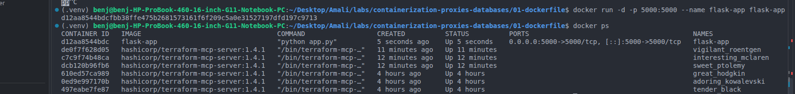

# Part 1: Dockerfile for a sample application

A small Flask app packaged into a Docker image and run as a container.

## Files

| File | Purpose |
|---|---|
| `app.py` | Flask app with one route (`/`) that returns `Hello from Docker!` on port 5000 |
| `requirements.txt` | Python dependencies (`flask`) |
| `Dockerfile` | Instructions for building the image |
| `.dockerignore` | Files kept out of the build context (cache files, screenshots, docs) |

## Dockerfile

```dockerfile
FROM python:3.11-slim
WORKDIR /app
COPY requirements.txt ./
RUN pip install -r requirements.txt
COPY . .
EXPOSE 5000
CMD ["python", "app.py"]
```

- `python:3.11-slim` is a small base image, so the final image is smaller and has less to patch.
- `requirements.txt` is copied and installed before the rest of the code. Docker caches each layer, so changing `app.py` only rebuilds the last `COPY` step and Flask is not reinstalled.
- `EXPOSE 5000` documents the port the app uses. The port is actually published with `-p` at run time.
- The app listens on `0.0.0.0` instead of `127.0.0.1`. Inside a container, `127.0.0.1` only accepts connections from the container itself, so traffic forwarded by Docker would never reach the app.

## Steps

Build the image:

```bash
docker build -t flask-app .
```

Run the container, mapping port 5000 on the host to port 5000 in the container:

```bash
docker run -d -p 5000:5000 --name flask-app flask-app
```

Check that it is running:

```bash
docker ps
```

Then open http://localhost:5000.

## Result

The app is reachable at http://localhost:5000:


`docker ps` shows the `flask-app` container running with port 5000 published:


