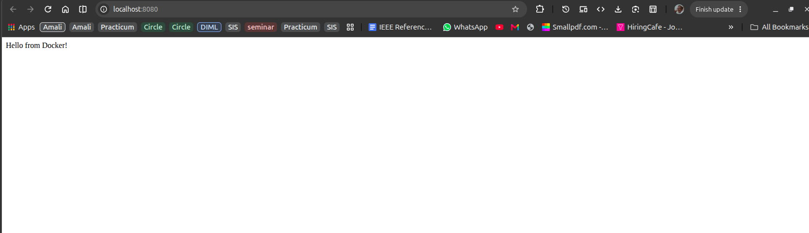
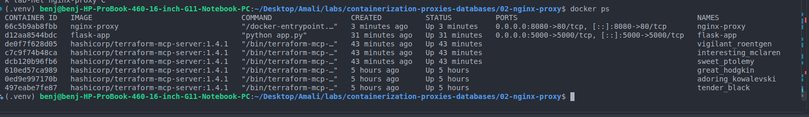

# Part 2: Reverse proxy with Nginx

An Nginx container that receives requests on port 8080 and forwards them to the Flask container from [Part 1](../01-dockerfile/).

```
browser ──:8080──▶ [ nginx-proxy ] ──http://flask-app:5000──▶ [ flask-app ]
                   └──────────── network: lab-net ────────────┘
```

## Files

| File | Purpose |
|---|---|
| `nginx.conf` | Nginx config: listen on port 80 and forward every request to `flask-app:5000` |
| `Dockerfile` | Builds on `nginx:alpine` and replaces the default config with `nginx.conf` |

## nginx.conf

```nginx
events {}

http {
  server {
    listen 80;

    location / {
      proxy_pass http://flask-app:5000;
    }
  }
}
```

- `listen 80` is the port Nginx uses inside its container. It is published as 8080 on the host.
- `location /` matches every path, and `proxy_pass` sends the request on to the Flask container.
- `flask-app` is the Flask container's name. Both containers are on the `lab-net` network, where Docker's built-in DNS resolves container names to their IP addresses.

## Problem: `host.docker.internal` does not resolve on Linux

The lab's config used `proxy_pass http://host.docker.internal:5000;`. On this machine the Nginx container exited straight away, and `docker logs` showed:

```
[emerg] host not found in upstream "host.docker.internal" in /etc/nginx/nginx.conf:8
```

`host.docker.internal` is a hostname that Docker Desktop (Mac and Windows) provides to reach the host. Docker Engine on Linux does not create it. `localhost` would not work either, because inside the Nginx container it refers to the Nginx container itself.

The fix was to put both containers on a user-defined network and point `proxy_pass` at the Flask container by name. Container-to-container traffic then stays inside Docker instead of going out through the host.

## Steps

The Flask container from Part 1 must already be running as `flask-app`.

Create a network and connect the Flask container to it:

```bash
docker network create lab-net
docker network connect lab-net flask-app
```

Build the Nginx image:

```bash
docker build -t nginx-proxy .
```

Run it on the same network, publishing port 8080:

```bash
docker run -d -p 8080:80 --name nginx-proxy --network lab-net nginx-proxy
```

The network is set with `docker run` rather than in the Dockerfile. A Dockerfile describes what is inside the image; networks, ports and names are decided when a container is started.

## Result

`curl -i localhost:8080` returns the Flask response, with `Server: nginx` showing the request went through the proxy:

```
HTTP/1.1 200 OK
Server: nginx/1.31.8
Content-Type: text/html; charset=utf-8
Content-Length: 18

Hello from Docker!
```

The app is reachable through the proxy at http://localhost:8080:



`docker ps` shows both containers running, with Nginx on port 8080 and Flask on port 5000:



## Cleanup

```bash
docker rm -f nginx-proxy flask-app
docker network rm lab-net
```
