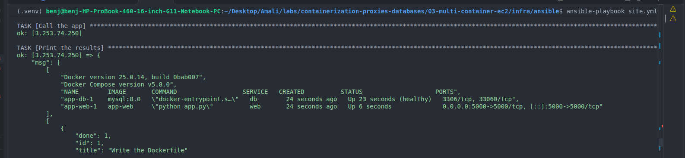
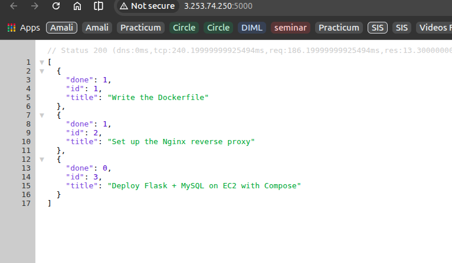
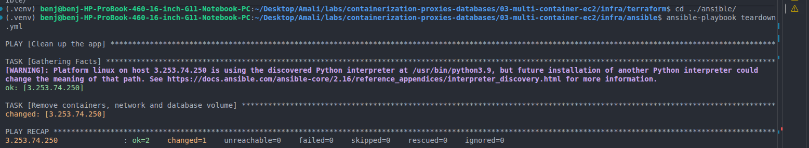

# Part 3: Multi-container app on EC2 (Flask + MySQL)

A two-tier app run with Docker Compose: a Flask API (`web`) that reads tasks from a MySQL database (`db`).

```
curl / browser ──:5000──▶ [ web: Flask ] ──host "db", port 3306──▶ [ db: MySQL 8.0 ]
                          └────────── default network (created by Compose) ──────────┘
                                                                        │
                                                         volume db_data (/var/lib/mysql)
                                                         init.sql (runs on first start)
```

## Layout

```
03-multi-container-ec2/
├── docker-compose.yml   # services: web, db
├── .env.example         # DB settings template (copy to .env, which is gitignored)
├── web/
│   ├── app.py           # Flask app, GET / returns all tasks as JSON
│   ├── requirements.txt # flask, pymysql, cryptography
│   ├── Dockerfile
│   └── .dockerignore
├── db/
│   └── init.sql         # creates the tasks table and inserts 3 rows
└── infra/               # Terraform (create EC2) + Ansible (deploy the app)
```

## How it fits together

### `db` service

- Uses the official `mysql:8.0` image.
- On first start, MySQL reads `MYSQL_DATABASE`, `MYSQL_USER` and `MYSQL_PASSWORD` and creates the database and an app user. The app never logs in as root.
- `db_data` is a named volume mounted at `/var/lib/mysql`, so the data survives `docker compose down` (unless `--volumes` is used).
- `init.sql` is mounted into `/docker-entrypoint-initdb.d/`. MySQL runs files in that folder only when the data volume is empty, so the table is created and seeded once.
- A healthcheck runs `mysqladmin ping` every 5 seconds. The service is marked `healthy` once MySQL accepts connections.
- Port 3306 is **not** published. Only `web` needs to reach the database, and it does that over the Compose network.

### `web` service

- Built from `web/Dockerfile` (`python:3.11-slim`, dependencies installed before the code is copied so the layer cache is reused).
- Publishes port 5000 on the host.
- Gets its connection settings from environment variables: `DB_HOST=db` plus the user, password and database from `.env`.
- `depends_on` with `condition: service_healthy` makes `web` wait until MySQL is ready, not just until the container has started.

### Networking

Compose creates a network for the project and registers each service name in its DNS. That is why the app connects to the host `db`. In Part 2 this had to be done by hand with `docker network create`.

### Secrets

Passwords live in `.env`, which is gitignored. `docker-compose.yml` only refers to them as `${MYSQL_PASSWORD}` and so on, and both services read the same values, so the app user always matches the one MySQL created.

## Run locally

From `03-multi-container-ec2/`:

```bash
cp .env.example .env          # then fill in the four values
docker compose config --quiet # checks the YAML is valid
docker compose up -d --build  # build web, create network + volume, start db, wait for healthy, start web
docker compose ps             # db should show (healthy)
curl http://localhost:5000    # returns the tasks as JSON
docker compose logs web       # app logs, if something fails
docker compose logs db        # MySQL logs, including init.sql
```

Local result:

```
NAME                           IMAGE                        SERVICE   STATUS                   PORTS
03-multi-container-ec2-db-1    mysql:8.0                    db        Up 7 minutes (healthy)   3306/tcp, 33060/tcp
03-multi-container-ec2-web-1   03-multi-container-ec2-web   web       Up 6 minutes             0.0.0.0:5000->5000/tcp
```

```json
[{"done":1,"id":1,"title":"Write the Dockerfile"},{"done":1,"id":2,"title":"Set up the Nginx reverse proxy"},{"done":0,"id":3,"title":"Deploy Flask + MySQL on EC2 with Compose"}]
```

## Deploy on EC2 (Terraform + Ansible)

The EC2 deployment is scripted in [`infra/`](infra/): Terraform builds the server, Ansible sets it up and deploys the app.

| File | Job |
|---|---|
| `terraform/versions.tf` | Terraform and provider versions (aws, tls, local) |
| `terraform/providers.tf` | AWS region |
| `terraform/variables.tf` | `region`, `my_ip`, `instance_type` |
| `terraform/main.tf` | SSH key, security group (22 and 5000 from my IP), Amazon Linux 2023 instance, writes `ansible/inventory.ini` |
| `terraform/outputs.tf` | Public IP, SSH command, app URL |
| `ansible/ansible.cfg` | Uses the generated inventory |
| `ansible/site.yml` | Installs Docker, Compose and buildx, copies the app and `.env`, runs `docker compose up --wait`, calls the app |
| `ansible/teardown.yml` | Runs `docker compose down --volumes` |

The private key, inventory, `.env`, `.tfvars` and Terraform state are gitignored.

### Infrastructure

- AMI: Amazon Linux 2023, latest, looked up from the public SSM parameter (Amazon Linux 2 reached end of support on 2026-06-30)
- Instance type: `t3.micro` (Free Tier), region `eu-west-1`
- Security group inbound rules:
  - SSH (22) from my IP only
  - Custom TCP (5000) from my IP only, for the app
  - MySQL (3306) is not opened

### 1. Create the server

```bash
cd infra/terraform
cp terraform.tfvars.example terraform.tfvars   # set my_ip to "<your-ip>/32"
curl -s https://checkip.amazonaws.com          # shows your public IP
terraform init
terraform apply
```

### 2. Deploy the app

```bash
cd ../ansible
ansible-playbook site.yml
```

The playbook installs Docker and the Compose and buildx plugins, copies `docker-compose.yml`, `.env`, `web/` and `db/` to `/home/ec2-user/app`, runs `docker compose up -d --build --wait`, then prints the versions, `docker compose ps` and the response from `curl http://localhost:5000`:

```
Docker version 25.0.14, build 0bab007
Docker Compose version v5.8.0
NAME        IMAGE       SERVICE   STATUS                    PORTS
app-db-1    mysql:8.0   db        Up 23 seconds (healthy)   3306/tcp, 33060/tcp
app-web-1   app-web     web       Up 6 seconds              0.0.0.0:5000->5000/tcp, [::]:5000->5000/tcp
```

```json
[{"done":1,"id":1,"title":"Write the Dockerfile"},{"done":1,"id":2,"title":"Set up the Nginx reverse proxy"},{"done":0,"id":3,"title":"Deploy Flask + MySQL on EC2 with Compose"}]
```

`web` started 17 seconds after `db`: it waited for the MySQL healthcheck to pass.



The app is reachable from the browser on port 5000:



### 3. Clean up

```bash
ansible-playbook teardown.yml   # docker compose down --volumes on the instance
cd ../terraform
terraform destroy               # removes the instance, security group and key pair
```

`docker compose down --volumes` removes both containers, the project network and the `db_data` volume, so no database data is left behind:



`terraform destroy` then removed the AWS resources. The instance shows as `terminated` in EC2.

## Problem: SSH timed out on the first deploy

The first `ansible-playbook site.yml` failed with:

```
ssh: connect to host 3.253.74.250 port 22: Connection timed out
```

`terraform.tfvars` still had the example IP from `terraform.tfvars.example` (`203.0.113.10/32`), so the security group only allowed SSH from that address and dropped my connection. A timeout (rather than "connection refused") usually means a firewall or security group is blocking the traffic. Setting `my_ip` to my real public IP and running `terraform apply` updated the security group in place, and the playbook then connected.

## Manual alternative

The same deployment without Terraform and Ansible, on an Amazon Linux 2023 instance launched from the console:

```bash
# Connect
chmod 400 my-key.pem
ssh -i my-key.pem ec2-user@<public-ip>

# Install Docker and Git
sudo dnf install -y docker git
sudo systemctl enable --now docker
sudo usermod -aG docker ec2-user   # log out and back in for this to apply

# Install the Compose and buildx plugins (not in the Amazon Linux repos)
sudo mkdir -p /usr/local/lib/docker/cli-plugins
sudo curl -SL https://github.com/docker/compose/releases/latest/download/docker-compose-linux-x86_64 \
  -o /usr/local/lib/docker/cli-plugins/docker-compose
BUILDX=$(curl -s https://api.github.com/repos/docker/buildx/releases/latest | grep -oP '"tag_name": "\K[^"]+')
sudo curl -SL "https://github.com/docker/buildx/releases/download/${BUILDX}/buildx-${BUILDX}.linux-amd64" \
  -o /usr/local/lib/docker/cli-plugins/docker-buildx
sudo chmod +x /usr/local/lib/docker/cli-plugins/*
docker --version && docker compose version

# Get the code, configure, run
git clone https://github.com/BenjaminSsempala/containerization-proxies-databases.git
cd containerization-proxies-databases/03-multi-container-ec2
cp .env.example .env && nano .env
docker compose up -d --build
curl http://localhost:5000

# Clean up
docker compose down --volumes
```
